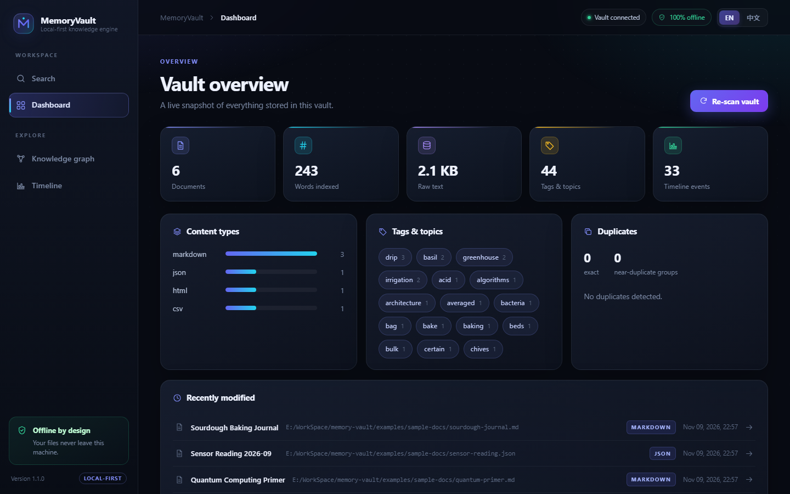
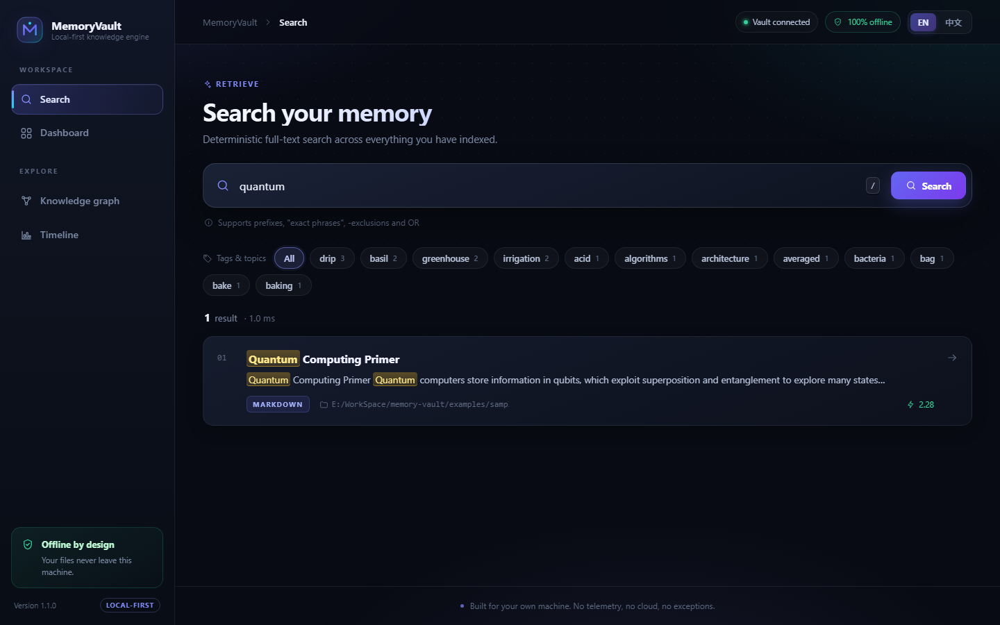
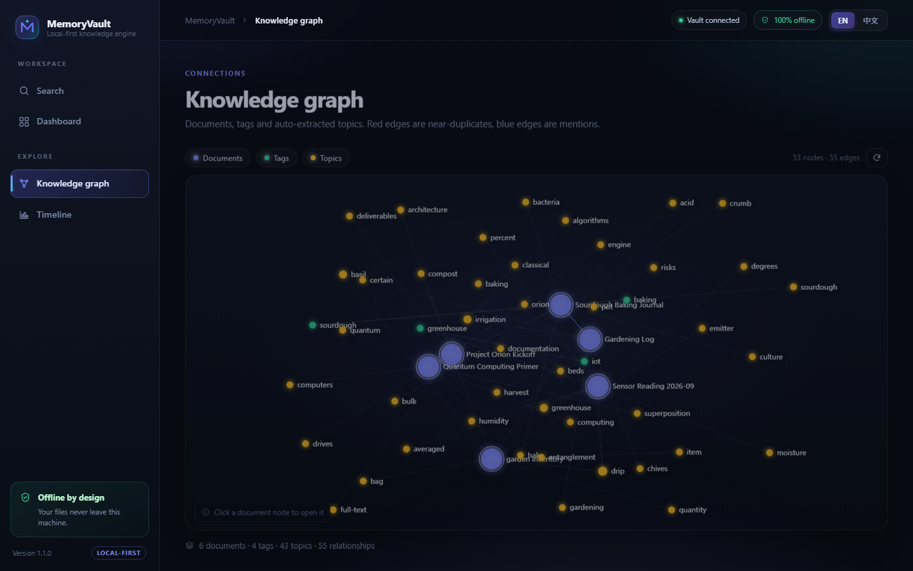
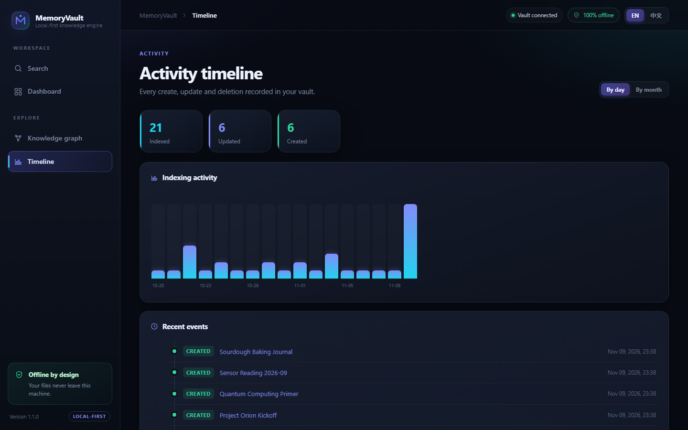

# MemoryVault

> A local-first personal knowledge management and digital memory engine.
> Index, organize, search and visualize your documents — **completely offline**.

**English (default)** · [简体中文](README.zh-CN.md)

[](.github/workflows/ci.yml)
[](pyproject.toml)
[](LICENSE)
[](tests/)



MemoryVault turns a folder of documents into a searchable, cross-linked
knowledge base: full-text search with BM25 ranking, duplicate detection,
an interactive knowledge graph and an activity timeline — all backed by a
single SQLite file on your own disk.

**Core principles**

1. **Local-first** — all data stays on your machine. No external API calls,
   no telemetry, no cloud. Ever.
2. **Deterministic core** — parsing, indexing and search work without AI.
3. **AI is an optional extension** — clean plugin interfaces exist
   (`EmbeddingProvider`, `SummaryProvider`), but none ship with network calls.

---

## Screenshots

All screenshots on this page show the **English interface**. The
[中文 README](README.zh-CN.md) contains the corresponding Chinese screenshots.

| Search — FTS5 results with highlighted snippets | Knowledge graph |
| :---: | :---: |
|  |  |
| **Activity timeline** | **Dashboard** |
|  |  |

The dashboard is bilingual. Use the **EN / 中文** switch in the top-right
corner, or force a language with `?lang=en` / `?lang=zh`. The choice is
stored in `localStorage`. See [UI languages](#ui-languages).

## Feature overview

| Phase | Capability | Where |
|-------|------------|-------|
| 1 | Parsers for TXT, LOG, Markdown, PDF, DOCX, HTML, JSON, CSV/TSV — extracting title, content, metadata, timestamps and SHA-256 hash | `src/memoryvault/parser/` |
| 2 | Incremental scanner: file watcher, hash-based change detection, re-index only what changed, delete what vanished | `src/memoryvault/indexer/scanner.py` |
| 3 | SQLite FTS5 search: inverted index, BM25 ranking, HTML-safe snippets with `<mark>` highlighting, prefix/phrase/NOT/OR query grammar | `src/memoryvault/search/` |
| 4 | Duplicate detection: exact SHA-256 groups + 64-bit SimHash near-duplicates with banded candidate lookup | `src/memoryvault/dedup/` |
| 5 | Knowledge graph: document/tag/topic nodes, `mentions` (wikilinks), `cooccurs`, `similar` edges | `src/memoryvault/graph/` |
| 6 | Timeline: append-only event log, per-document history, activity histogram | `src/memoryvault/timeline/` |
| 7 | React dashboard: Search, Document viewer, Graph, Timeline, Dashboard — redesigned in 1.1 with a full design system | `frontend/` |
| 8 | Optional AI plugin interfaces (abstractions only — no external calls) | `src/memoryvault/ai/` |
| 9 | Bilingual UI (English / 简体中文), deterministic CJK-friendly keyword extraction | `frontend/src/i18n.js` |
| 10 | Hardening: thread-safe SQLite access, escaped highlights, localhost-only CORS, SPA path-traversal guard | `src/memoryvault/` |

## Architecture

```
                        ┌──────────────────────────────────────────────┐
                        │                 React dashboard              │
                        │   Search │ Document viewer │ Graph │ Timeline│
                        └───────────────────────┬──────────────────────┘
                                                │ HTTP (localhost only)
                        ┌───────────────────────▼──────────────────────┐
                        │              FastAPI application             │
                        │  /api/search /api/documents /api/graph       │
                        │  /api/timeline /api/duplicates /api/scan     │
                        └───────┬───────────────┬──────────────┬───────┘
                                │               │              │
                 ┌──────────────▼───┐   ┌───────▼──────┐  ┌────▼─────────┐
                 │   Search engine  │   │ Graph builder│  │  Timeline    │
                 │  FTS5 + BM25     │   │ nodes/edges  │  │  service     │
                 └──────────────┬───┘   └───────┬──────┘  └────┬─────────┘
                                │               │              │
┌──────────────┐   ┌────────────▼───────────────▼──────────────▼─────────┐
│ File system  │   │              DocumentRepository (SQLite)            │
│ TXT/MD/PDF/  ├──►│  documents │ documents_fts │ tags │ events │ bands  │
│ DOCX/HTML/   │   └────────────────────────────▲────────────────────────┘
│ JSON/CSV     │                                │
└──────┬───────┘                 ┌──────────────┴──────────────┐
       │                         │        Index engine         │
┌──────▼───────┐                 │  parse → hash → simhash →   │
│ Incremental  ├────────────────►│  keywords → upsert          │
│ scanner +    │                 └──────────────┬──────────────┘
│ watcher      │                                │
└──────────────┘                  ┌─────────────▼─────────────┐
                                  │  Optional AI providers    │
                                  │  (Embedding / Summary)    │
                                  │  abstractions only —      │
                                  │  no network calls shipped │
                                  └───────────────────────────┘
```

The same diagram as rendered Mermaid lives in
[docs/architecture.md](docs/architecture.md).

### Data flow

1. The **incremental scanner** walks configured directories, skipping
   unchanged files via `(size, SHA-256)` comparison.
2. The **index engine** parses each changed file, computes content hashes and
   a SimHash fingerprint, extracts deterministic keyword topics, and upserts
   the document atomically (tables + FTS5 + tags + event log).
3. **Search** translates user queries into safe FTS5 `MATCH` expressions and
   returns BM25-ranked results with escaped, highlighted snippets.
4. The **graph builder** materializes documents/tags/topics and relationships
   on demand — no separate graph database required.
5. The React dashboard talks to the FastAPI server on `127.0.0.1` only.

## Quick start

### pip

```bash
pip install -e .

memoryvault index ~/Documents/notes          # one-shot incremental index
memoryvault search "neural networks"          # ranked keyword search
memoryvault watch ~/Documents/notes           # live re-indexing on change
memoryvault scan                              # re-scan previously indexed roots
memoryvault stats                             # vault statistics
memoryvault duplicates                        # exact + near duplicates
memoryvault graph --out graph.json            # export knowledge graph
memoryvault serve                             # API + dashboard on :8000
```

If the console script is not on your `PATH`, the exact same CLI is available
as `python -m memoryvault ...`.

The default vault lives at `~/.memoryvault/memoryvault.db`
(override with `MEMORYVAULT_HOME` or `--db`).

### Docker

```bash
docker compose up --build
# open http://127.0.0.1:8000 — the dashboard with sample documents
```

The compose file mounts `examples/sample-docs` read-only at `/docs` and keeps
the SQLite vault in a named volume.

### Frontend development

```bash
cd frontend
npm ci
npm run dev          # vite dev server on :5173, proxying /api to :8000
npm test             # 18 node:test unit tests (i18n, formatting, API)
npm run build        # production bundle in frontend/dist
```

`memoryvault serve` automatically serves `frontend/dist` when it exists.

## UI languages

The dashboard ships with a complete English and Simplified Chinese UI,
including navigation, empty states, chart labels, event types and error
messages. No translation service is involved — both dictionaries are local
files ([i18n.js](frontend/src/i18n.js)).

| Method | Example |
|--------|---------|
| Top-right switch | `EN` / `中文` — persisted in `localStorage` |
| URL override | `http://127.0.0.1:8000/?lang=zh` |
| Browser default | Detected from `navigator.language`, falling back to English |

Document content is never translated; it is always displayed exactly as
indexed. A Chinese-language sample set lives in
[examples/sample-docs-zh](examples/sample-docs-zh).

To reproduce the screenshots in this repository, build a demo vault with a
realistic activity history and capture the pages with any headless browser:

```bash
python scripts/make_demo_vault.py examples/sample-docs --db /tmp/en.db
memoryvault --db /tmp/en.db serve --port 8000
# then open /dashboard?lang=en, /?lang=en&q=quantum, /graph?lang=en, ...
```

## Python API

```python
from memoryvault import Vault

with Vault.open("my-vault.db") as vault:
    vault.index("notes/")                          # incremental
    hits = vault.search.search("quantum")          # BM25-ranked
    graph = vault.graph.build()                    # nodes + edges
    dups = vault.dedup.find_all()                  # exact + similar
    history = vault.timeline.document_history(1)   # one document's events
```

Every subsystem is usable standalone — the API layer is a thin wrapper.

## Optional AI extensions

MemoryVault never calls external services. Applications that embed it can
register providers for semantic search or summarization:

```python
from memoryvault.ai import Registry, HashingEmbeddingProvider, NullSummaryProvider

registry = Registry()
registry.register_embedding(HashingEmbeddingProvider(dimension=256), default=True)
registry.register_summary(NullSummaryProvider())

vectors = registry.embedding().embed(["some document text"])
summary = registry.summary().summarize(long_text, max_length=280)
```

The two shipped implementations are local and deterministic (feature hashing
and extractive truncation) — they exist to define the contract, not to call
out to a model. Plug in a local model runner (e.g. ONNX) by implementing
`EmbeddingProvider` / `SummaryProvider`.

## Configuration

| Option | Default | Meaning |
|--------|---------|---------|
| `MEMORYVAULT_HOME` | `~/.memoryvault` | Directory holding `memoryvault.db` |
| `MEMORYVAULT_API_HOST` | `127.0.0.1` | Bind address for `serve` (containers use `0.0.0.0`) |
| `MEMORYVAULT_API_PORT` | `8000` | Port for `serve` |
| `MEMORYVAULT_CORS_ORIGINS` | localhost only | Comma-separated extra CORS origins (replaces the loopback allow-list) |
| `--db PATH` | — | Explicit vault file location |
| `max_file_size` | 64 MiB | Files above are skipped |
| `simhash_threshold` | 12 | Hamming distance for near-duplicates |
| `topics_per_document` | 8 | Auto-extracted keywords per document |
| `watcher_debounce_seconds` | 1.0 | Settle time before a watcher re-scan |

Indexed directories are remembered inside the vault itself (`watch_roots`),
so `memoryvault scan` and the dashboard's **Re-scan vault** button work even
when no watch paths are configured.

## Supported formats

| Format | Extensions | Title source | Metadata |
|--------|-----------|--------------|----------|
| Plain text | `.txt` `.text` `.log` | first line | — |
| Markdown | `.md` `.markdown` | frontmatter → `#` heading | frontmatter, tags, wikilinks, headings |
| PDF | `.pdf` | docinfo → first line | author/subject, page count |
| Word | `.docx` | core properties → first paragraph | author, headings |
| HTML | `.html` `.htm` | `<title>` → `<h1>` | meta tags, headings |
| JSON | `.json` | `title`/`name` key | declared keys, tags |
| CSV/TSV | `.csv` `.tsv` | file name | columns, row count, delimiter |

The indexable extension list is derived from the parser registry, so a newly
registered format is picked up automatically.

## Data and upgrades

Everything lives in one SQLite file (WAL mode). Schema version **2** extends
the `document_tags` primary key with `source`, so one term can be both an
explicit tag and an auto-extracted topic on the same document. Vaults created
by 1.0.0 are migrated in place on first open; no data is lost. Back up the
`.db` file before upgrading if it is valuable to you.

## Testing

```bash
pip install -e ".[dev]"
pytest tests/ -v                 # 222 Python tests
cd frontend && npm ci && npm test  # 18 frontend tests
python scripts/smoke_cli.py       # cross-platform CLI smoke test
python scripts/check_docs.py      # README links + screenshots
```

240 tests cover parsing, indexing, incremental scanning, search ranking and
safe highlighting, database integrity and schema migration, concurrent API
access, duplicate detection, the knowledge graph, the timeline, the HTTP API,
the CLI and the frontend helpers — across Linux, macOS and Windows in CI.

## Project layout

```
memoryvault/
├── src/memoryvault/
│   ├── parser/        # format parsers (TXT, LOG, MD, PDF, DOCX, HTML, JSON, CSV/TSV)
│   ├── indexer/       # index engine + incremental scanner + file watcher
│   ├── search/        # FTS5 search engine, query builder, BM25, safe snippets
│   ├── database/      # schema/migrations, locked connection, repository
│   ├── graph/         # knowledge-graph builder
│   ├── dedup/         # SimHash + duplicate detector
│   ├── timeline/      # activity and document history
│   ├── api/           # FastAPI application
│   ├── ai/            # optional provider abstractions (no network calls)
│   ├── cli/           # `memoryvault` command-line interface
│   └── vault.py       # facade wiring every subsystem together
├── frontend/          # React dashboard (Vite) + i18n + unit tests
├── tests/             # 222 pytest tests
├── scripts/           # CLI/HTTP smoke tests, demo vault builder, doc checks
├── docs/screenshots/  # EN + ZH screenshots used by the READMEs
├── examples/sample-docs/ · examples/sample-docs-zh/
├── docs/architecture.md
├── Dockerfile · docker-compose.yml · .github/workflows/ci.yml
└── LICENSE (MIT)
```

## Roadmap ideas

* Semantic search wired to the `EmbeddingProvider` interface (local models only)
* Dictionary-based Chinese/Japanese word segmentation for richer auto topics
* Annotation and highlighting inside the document viewer
* Export to static site / Obsidian vault
* Attachment and image OCR indexing

## Contributing

Issues and pull requests welcome. Please read
[CONTRIBUTING.md](CONTRIBUTING.md) and run `pytest`, `npm test`,
`npm run build` and `python scripts/smoke_cli.py` before submitting; CI
enforces all of them plus the Docker and documentation smoke tests.

## Security

MemoryVault is a single-user, localhost-only application. It has **no
authentication layer**: anyone who can reach the HTTP port can read the whole
vault.

* The API binds to `127.0.0.1` by default. Only bind `0.0.0.0` inside a
  container or behind your own reverse proxy / firewall.
* Cross-origin access is limited to `localhost`, `127.0.0.1` and `[::1]`.
  Use `MEMORYVAULT_CORS_ORIGINS` to define an explicit allow-list instead.
* Search titles and snippets are HTML-escaped on the server and rendered as
  React text nodes, never as raw HTML, so document content cannot inject
  markup into the dashboard.
* The static-file fallback resolves every path inside the frontend bundle
  only; traversal attempts and unknown `/api/*` routes are rejected.
* No telemetry, no analytics, no outbound network calls, no stored credentials.
* To report a vulnerability, open a GitHub issue — never attach private
  documents. See [CHANGELOG.md](CHANGELOG.md) for the hardening history.

## License

[MIT](LICENSE) — © 2026 MemoryVault Contributors.

Permission is hereby granted, free of charge, to any person obtaining a copy
of this software and associated documentation files (the "Software"), to deal
in the Software without restriction, including without limitation the rights
to use, copy, modify, merge, publish, distribute, sublicense, and/or sell
copies of the Software. The above copyright notice and this permission notice
shall be included in all copies or substantial portions of the Software.
THE SOFTWARE IS PROVIDED "AS IS", WITHOUT WARRANTY OF ANY KIND.
