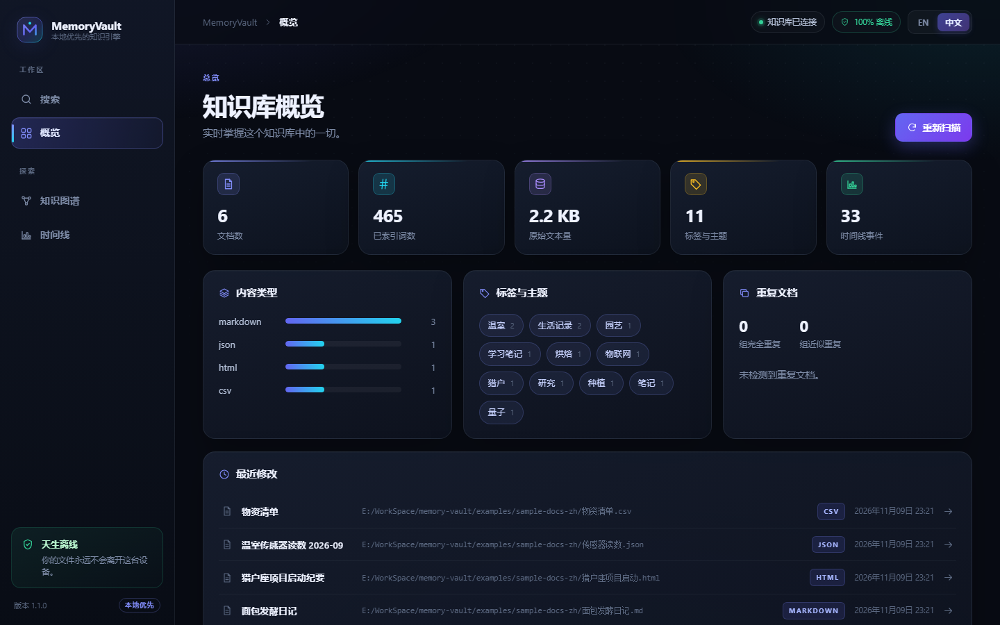
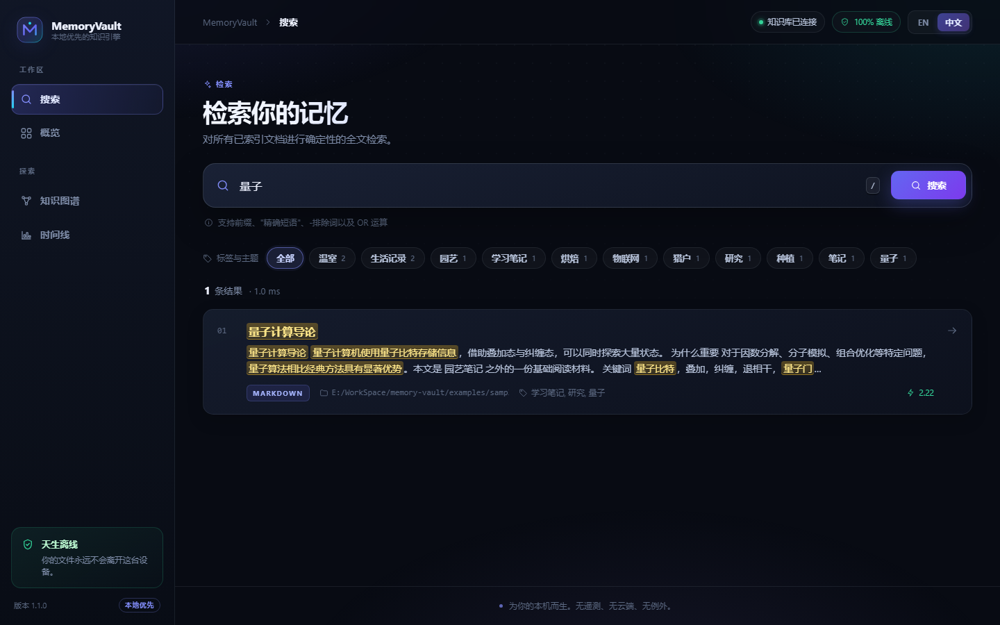
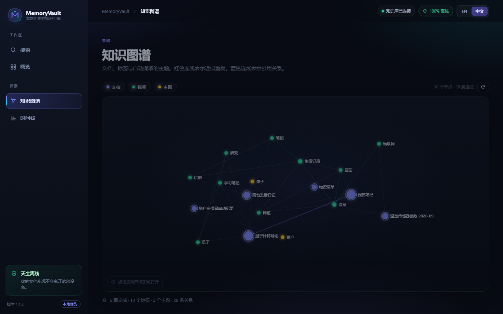
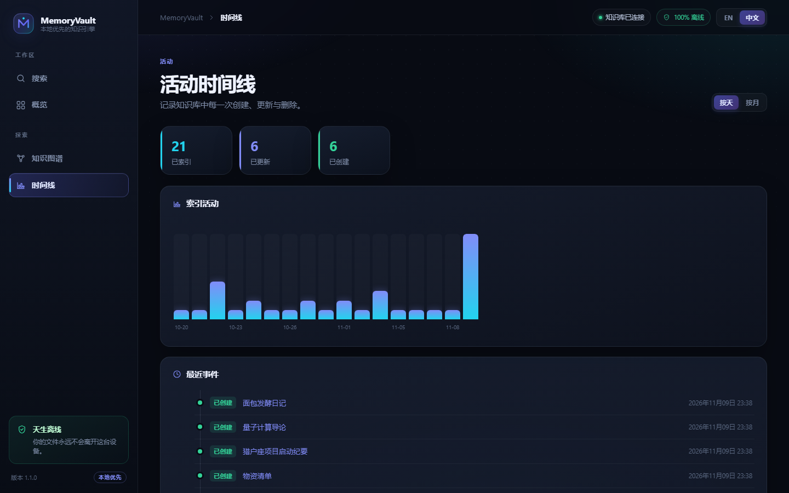

# MemoryVault

> 本地优先的个人知识管理与数字记忆引擎。
> 索引、整理、检索并可视化你的文档——**完全离线**。

[English (default)](README.md) · **简体中文**

[](.github/workflows/ci.yml)
[](pyproject.toml)
[](LICENSE)
[](tests/)



MemoryVault 能把一个装满文档的文件夹变成可检索、可关联的知识库：基于 BM25
排序的全文检索、重复文档检测、交互式知识图谱与活动时间线，全部存放在本机
的一个 SQLite 文件里。

**核心原则**

1. **本地优先**——所有数据都留在你的设备上。没有外部 API 调用、没有遥测、没有云端。
2. **确定性内核**——解析、索引与检索不依赖任何 AI。
3. **AI 只是可选扩展**——提供清晰的插件接口（`EmbeddingProvider`、
   `SummaryProvider`），但内置实现不会发起任何网络请求。

---

## 界面截图

本页所有截图均为**中文界面**；[英文 README](README.md) 中是对应的英文界面截图。

| 搜索 — FTS5 结果与高亮片段 | 知识图谱 |
| :---: | :---: |
|  |  |
| **活动时间线** | **仪表盘** |
|  |  |

仪表盘内置中英双语。点击右上角的 **EN / 中文** 即可切换（偏好保存在
`localStorage`），也可以直接用 `?lang=en` / `?lang=zh` 指定语言，详见
[界面语言](#界面语言)。

## 功能一览

| 阶段 | 能力 | 代码位置 |
|------|------|----------|
| 1 | TXT、LOG、Markdown、PDF、DOCX、HTML、JSON、CSV/TSV 解析器，提取标题、正文、元数据、时间戳与 SHA-256 | `src/memoryvault/parser/` |
| 2 | 增量扫描器：文件监听、哈希变更检测、仅重建变化的文件、清理已消失的文件 | `src/memoryvault/indexer/scanner.py` |
| 3 | SQLite FTS5 检索：倒排索引、BM25 排序、HTML 安全的 `<mark>` 高亮片段，支持前缀/短语/排除/OR 语法 | `src/memoryvault/search/` |
| 4 | 重复检测：SHA-256 完全重复分组 + 64 位 SimHash 近似重复与分带候选查询 | `src/memoryvault/dedup/` |
| 5 | 知识图谱：文档/标签/主题节点，`mentions`（维基链接）、`cooccurs`、`similar` 关系 | `src/memoryvault/graph/` |
| 6 | 时间线：只追加的事件日志、单文档历史、活动直方图 | `src/memoryvault/timeline/` |
| 7 | React 仪表盘：搜索、文档查看、图谱、时间线、总览；1.1 版本重做了完整设计系统 | `frontend/` |
| 8 | 可选 AI 插件接口（仅抽象层，不含外部调用） | `src/memoryvault/ai/` |
| 9 | 中英双语界面，以及确定性的中文关键词提取 | `frontend/src/i18n.js` |
| 10 | 加固：线程安全的 SQLite 访问、转义高亮、仅本机 CORS、静态资源路径穿越防护 | `src/memoryvault/` |

## 架构

```
                        ┌──────────────────────────────────────────────┐
                        │                 React 仪表盘                 │
                        │   搜索 │ 文档查看 │ 图谱 │ 时间线 │ 总览    │
                        └───────────────────────┬──────────────────────┘
                                                │ HTTP（仅本机）
                        ┌───────────────────────▼──────────────────────┐
                        │              FastAPI 应用                    │
                        │  /api/search /api/documents /api/graph       │
                        │  /api/timeline /api/duplicates /api/scan     │
                        └───────┬───────────────┬──────────────┬───────┘
                                │               │              │
                 ┌──────────────▼───┐   ┌───────▼──────┐  ┌────▼─────────┐
                 │     检索引擎      │   │   图谱构建    │  │   时间服务    │
                 │   FTS5 + BM25    │   │  节点 / 关系  │  │              │
                 └──────────────┬───┘   └───────┬──────┘  └────┬─────────┘
                                │               │              │
┌──────────────┐   ┌────────────▼───────────────▼──────────────▼─────────┐
│   文件系统    │   │           DocumentRepository (SQLite)                │
│ TXT/MD/PDF/  ├──►│  documents │ documents_fts │ tags │ events │ bands  │
│ DOCX/HTML/   │   └────────────────────────────▲────────────────────────┘
│ JSON/CSV     │                                │
└──────┬───────┘                 ┌──────────────┴──────────────┐
       │                         │          索引引擎             │
┌──────▼───────┐                 │  解析 → 哈希 → SimHash →      │
│ 增量扫描器 +  ├────────────────►│  关键词 → 原子写入             │
│ 文件监听      │                 └──────────────┬──────────────┘
└──────────────┘                  ┌─────────────▼─────────────┐
                                  │      可选 AI 提供者         │
                                  │   (Embedding / Summary)    │
                                  │   仅抽象层 — 无网络调用      │
                                  └───────────────────────────┘
```

Mermaid 版本见 [docs/architecture.md](docs/architecture.md)。

### 数据流

1. **增量扫描器**遍历配置目录，用 `(文件大小, SHA-256)` 跳过未变化的文件。
2. **索引引擎**解析变化的文件，计算内容哈希与 SimHash 指纹，提取确定性关键词主题，
   并以原子方式写入（主表 + FTS5 + 标签 + 事件日志）。
3. **检索**把用户输入转换成安全的 FTS5 `MATCH` 表达式，返回按 BM25 排序、
   且已转义的高亮结果。
4. **图谱构建器**按需生成文档/标签/主题及关系，不需要独立的图数据库。
5. React 仪表盘只与 `127.0.0.1` 上的 FastAPI 服务通信。

## 快速开始

### pip 安装

```bash
pip install -e .

memoryvault index ~/Documents/notes          # 一次性增量索引
memoryvault search "neural networks"          # 排序后的关键词检索
memoryvault watch ~/Documents/notes           # 文件变化时实时重建索引
memoryvault scan                              # 重新扫描曾索引过的目录
memoryvault stats                             # 知识库统计
memoryvault duplicates                        # 完全重复 + 近似重复
memoryvault graph --out graph.json            # 导出知识图谱
memoryvault serve                             # 在 :8000 启动 API + 仪表盘
```

如果 `memoryvault` 命令不在 `PATH` 中，可以用等价的 `python -m memoryvault ...`。

默认知识库位于 `~/.memoryvault/memoryvault.db`
（可用 `MEMORYVAULT_HOME` 或 `--db` 覆盖）。

### Docker

```bash
docker compose up --build
# 打开 http://127.0.0.1:8000 —— 带示例文档的仪表盘
```

compose 文件把 `examples/sample-docs` 以只读方式挂载到 `/docs`，
SQLite 数据库保存在命名卷中。

### 前端开发

```bash
cd frontend
npm ci
npm run dev          # vite 开发服务器 :5173，把 /api 代理到 :8000
npm test             # 18 个 node:test 单元测试（i18n、格式化、API）
npm run build        # 产物输出到 frontend/dist
```

`memoryvault serve` 会自动托管已构建的 `frontend/dist`。

## 界面语言

仪表盘提供完整的英文与简体中文界面，涵盖导航、空状态、图表标签、事件类型与错误提示。
不依赖任何翻译服务，两份词表都是本地文件（[i18n.js](frontend/src/i18n.js)）。

| 方式 | 示例 |
|------|------|
| 右上角开关 | `EN` / `中文`，偏好保存在 `localStorage` |
| URL 指定 | `http://127.0.0.1:8000/?lang=zh` |
| 浏览器默认 | 读取 `navigator.language`，无法识别时回退到英文 |

文档正文永远不会被翻译，始终按索引时的原文展示。中文示例文档位于
[examples/sample-docs-zh](examples/sample-docs-zh)。

复现本仓库截图：先用脚本生成带真实活动历史的演示知识库，再用任意无头浏览器截图：

```bash
python scripts/make_demo_vault.py examples/sample-docs-zh --db /tmp/zh.db
memoryvault --db /tmp/zh.db serve --port 8001
# 依次访问 /dashboard?lang=zh、/?lang=zh&q=量子、/graph?lang=zh 等
```

## Python API

```python
from memoryvault import Vault

with Vault.open("my-vault.db") as vault:
    vault.index("notes/")                          # 增量索引
    hits = vault.search.search("quantum")          # BM25 排序
    graph = vault.graph.build()                    # 节点 + 关系
    dups = vault.dedup.find_all()                  # 完全重复 + 近似重复
    history = vault.timeline.document_history(1)   # 单文档事件
```

每个子系统都可以独立使用，HTTP 层只是一层薄封装。

## 可选 AI 扩展

MemoryVault 从不调用外部服务。嵌入它的应用可以自行注册语义检索或摘要提供者：

```python
from memoryvault.ai import Registry, HashingEmbeddingProvider, NullSummaryProvider

registry = Registry()
registry.register_embedding(HashingEmbeddingProvider(dimension=256), default=True)
registry.register_summary(NullSummaryProvider())

vectors = registry.embedding().embed(["some document text"])
summary = registry.summary().summarize(long_text, max_length=280)
```

内置的两种实现都是本地且确定性的（特征哈希、抽取式截断），目的是定义接口契约，
而不是调用模型。实现 `EmbeddingProvider` / `SummaryProvider` 即可接入本地模型
（例如 ONNX）。

## 配置项

| 选项 | 默认值 | 含义 |
|------|--------|------|
| `MEMORYVAULT_HOME` | `~/.memoryvault` | 存放 `memoryvault.db` 的目录 |
| `MEMORYVAULT_API_HOST` | `127.0.0.1` | `serve` 监听地址（容器内使用 `0.0.0.0`） |
| `MEMORYVAULT_API_PORT` | `8000` | `serve` 端口 |
| `MEMORYVAULT_CORS_ORIGINS` | 仅本机 | 逗号分隔的额外 CORS 来源，会替换回环地址白名单 |
| `--db PATH` | — | 显式指定知识库文件 |
| `max_file_size` | 64 MiB | 超过该大小的文件跳过 |
| `simhash_threshold` | 12 | 判定近似重复的汉明距离阈值 |
| `topics_per_document` | 8 | 每篇文档自动提取的关键词数 |
| `watcher_debounce_seconds` | 1.0 | 文件监听触发重建前的稳定等待时间 |

已索引的目录会记录在知识库内部（`watch_roots`），因此即使没有配置监听路径，
`memoryvault scan` 和仪表盘上的**重新扫描**按钮也能正常工作。

## 支持的文件格式

| 格式 | 扩展名 | 标题来源 | 元数据 |
|------|--------|----------|--------|
| 纯文本 | `.txt` `.text` `.log` | 第一行 | — |
| Markdown | `.md` `.markdown` | frontmatter → `#` 标题 | frontmatter、标签、维基链接、标题层级 |
| PDF | `.pdf` | 文档信息 → 首行 | 作者/主题、页数 |
| Word | `.docx` | 核心属性 → 首段 | 作者、标题 |
| HTML | `.html` `.htm` | `<title>` → `<h1>` | meta 标签、标题 |
| JSON | `.json` | `title`/`name` 字段 | 声明的字段、标签 |
| CSV/TSV | `.csv` `.tsv` | 文件名 | 列名、行数、分隔符 |

可索引扩展名直接来自解析器注册表，新增解析器后会自动生效。

## 数据与升级

所有内容都在一个 SQLite 文件里（WAL 模式）。架构版本 **2** 把 `document_tags`
的主键扩展为包含 `source`，使同一个词既能是显式标签，也能是自动提取的主题。
1.0.0 创建的知识库会在首次打开时就地迁移，不会丢失数据；重要数据仍建议先备份
`.db` 文件。

## 测试

```bash
pip install -e ".[dev]"
pytest tests/ -v                  # 222 个 Python 测试
cd frontend && npm ci && npm test  # 18 个前端测试
python scripts/smoke_cli.py        # 跨平台 CLI 冒烟测试
python scripts/check_docs.py       # README 链接与截图检查
```

共 240 个测试，覆盖解析、索引、增量扫描、排序与安全高亮、数据库完整性与架构迁移、
并发 API 访问、重复检测、知识图谱、时间线、HTTP API、CLI 以及前端辅助函数；
CI 会在 Linux、macOS、Windows 上运行。

## 目录结构

```
memoryvault/
├── src/memoryvault/
│   ├── parser/        # 各格式解析器（TXT、LOG、MD、PDF、DOCX、HTML、JSON、CSV/TSV）
│   ├── indexer/       # 索引引擎 + 增量扫描器 + 文件监听
│   ├── search/        # FTS5 检索、查询构造、BM25、安全片段
│   ├── database/      # 架构/迁移、加锁连接、仓储层
│   ├── graph/         # 知识图谱构建
│   ├── dedup/         # SimHash + 重复检测
│   ├── timeline/      # 活动与文档历史
│   ├── api/           # FastAPI 应用
│   ├── ai/            # 可选提供者抽象（无网络调用）
│   ├── cli/           # `memoryvault` 命令行
│   └── vault.py       # 组装所有子系统的门面
├── frontend/          # React 仪表盘（Vite）+ 国际化 + 单元测试
├── tests/             # 222 个 pytest 测试
├── scripts/           # CLI / HTTP 冒烟、演示知识库、文档检查
├── docs/screenshots/  # README 使用的中英文截图
├── examples/sample-docs/ · examples/sample-docs-zh/
├── docs/architecture.md
├── Dockerfile · docker-compose.yml · .github/workflows/ci.yml
└── LICENSE (MIT)
```

## 后续计划

* 把 `EmbeddingProvider` 接入语义检索（仅限本地模型）
* 基于词典的中日文分词，提升自动主题质量
* 文档查看器内的批注与高亮
* 导出为静态站点 / Obsidian 库
* 附件与图片 OCR 索引

## 参与贡献

欢迎提交 issue 与 PR。请先阅读 [CONTRIBUTING.md](CONTRIBUTING.md)，
并在提交前运行 `pytest`、`npm test`、`npm run build` 与
`python scripts/smoke_cli.py`；CI 还会额外执行 Docker 与文档冒烟测试。

## Security

MemoryVault is a single-user, localhost-only application. It has **no
authentication layer**: anyone who can reach the HTTP port can read the whole
vault.

* The API binds to `127.0.0.1` by default. Only bind `0.0.0.0` inside a
  container or behind your own reverse proxy / firewall.
* Cross-origin access is limited to `localhost`, `127.0.0.1` and `[::1]`.
  Use `MEMORYVAULT_CORS_ORIGINS` to define an explicit allow-list instead.
* Search titles and snippets are HTML-escaped on the server and rendered as
  React text nodes, never as raw HTML, so document content cannot inject
  markup into the dashboard.
* The static-file fallback resolves every path inside the frontend bundle
  only; traversal attempts and unknown `/api/*` routes are rejected.
* No telemetry, no analytics, no outbound network calls, no stored credentials.
* To report a vulnerability, open a GitHub issue — never attach private
  documents. See [CHANGELOG.md](CHANGELOG.md) for the hardening history.

## License

[MIT](LICENSE) — © 2026 MemoryVault Contributors.

Permission is hereby granted, free of charge, to any person obtaining a copy
of this software and associated documentation files (the "Software"), to deal
in the Software without restriction, including without limitation the rights
to use, copy, modify, merge, publish, distribute, sublicense, and/or sell
copies of the Software. The above copyright notice and this permission notice
shall be included in all copies or substantial portions of the Software.
THE SOFTWARE IS PROVIDED "AS IS", WITHOUT WARRANTY OF ANY KIND.
